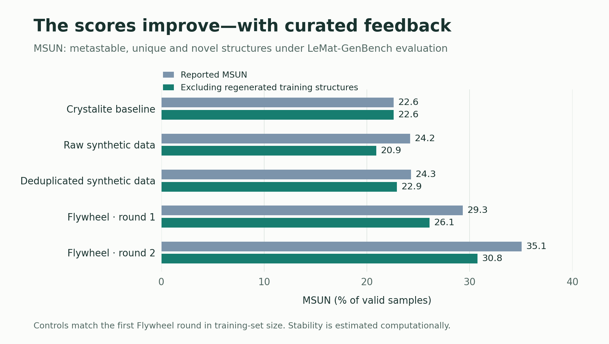
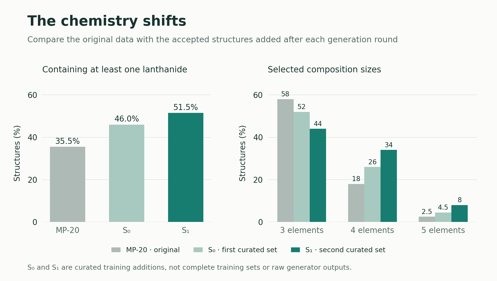
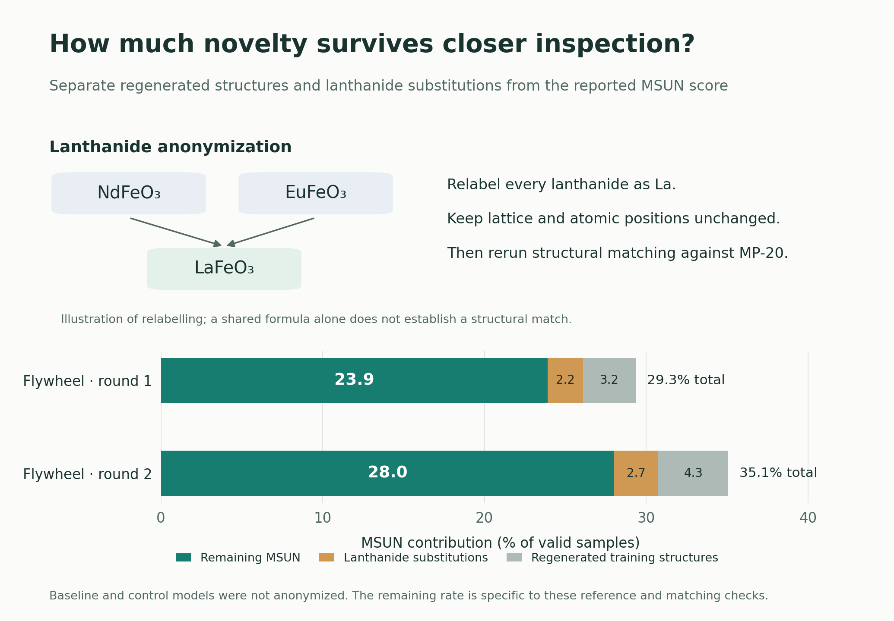

# Closing the loop on crystal generation
Having just completed my master's thesis at the University of Amsterdam under the guidance of Tin Hadži Veljković, I thought I would write a short blog post going through what we managed to accomplish. The title: "Lightweight Diffusion Transformers and Verifier-Curated Self-Improvement for Crystalline Materials Discovery" (rolls off the tongue, I know) gives a good hint as to what you might expect to find in its contents.

The first part: "Lightweight Diffusion Transformers [...] for Crystalline Materials Discovery" references [Crystalite](https://arxiv.org/abs/2604.02270) - a SOTA generative model that I got to work on, forming a major component of my thesis. I won't discuss it much here because Tin has an awesome [blog post](https://stases.github.io/blogposts/crystalite/) about it that gets into the details of the modelling and representation decisions. The important thing to take away from it, which largely informs the second part of my thesis, is that it has strong generation quality combined with substantially faster sampling than the baselines we evaluated. With the ability to sample quality crystals at an incredibly fast rate, we asked what we might do with this distinct advantage.

That brings us to the second part: “Verifier-Curated Self-Improvement for Crystalline Materials Discovery”. Crystalite’s sampling speed makes it practical to investigate what happens when a crystal generator is recursively trained on its own outputs. Machine-learned interatomic potentials (MLIPs) let us relax the generated structures and estimate their energies at a fraction of the cost of density functional theory (DFT). Together, these tools allow us to build an efficient self-training loop: generate a large pool of candidates, filter for novelty and estimated thermodynamic stability, and add the accepted structures to the original training data. We can then train a fresh generator on the expanded dataset and repeat the process. This is my second contribution: Flywheel. This little animation here gives a pretty good overview of the whole thing.

## Results

So what happens when you train a crystal generator on its own outputs?

### The Scores Improve!

After two rounds of Flywheel, Crystalite’s metastable, unique and novel (**MSUN**) rate rose from **22.6% to 35.1%**. Adding raw or simply deduplicated synthetic data produced smaller gains; the full curation pipeline made the larger difference.

*MSUN is measured over valid samples using computational stability estimates. The controls match round 1 in training-set size; darker bars exclude regenerated synthetic training examples.*

### The Chemistry Shifts

The curated additions also started to look different from the original data. Lanthanide-bearing structures became more common, alongside compositions containing more distinct elements. The feedback loop was changing the chemistry represented in the next model’s training data.

*S₀ and S₁ contain accepted outputs from the baseline and round-1 generators, respectively. They are curated additions, rather than complete training sets or unfiltered outputs; composition-size percentages are approximate.*

### The Scores Improve?

That chemistry shift prompted a closer look at novelty. Some outputs reproduced synthetic training examples; others matched familiar MP-20 frameworks once we treated all lanthanides as the same element. To identify the latter, I relabelled lanthanide sites as La and repeated the structural comparison while keeping the geometry unchanged.

*The formula example illustrates relabelling; geometry must also match. The bars partition reported MSUN into regeneration, additional matches exposed by anonymization, and the remainder. Baseline and control models were not anonymized.*

After both checks, the final rate was **28.0%**. A substantial part of the headline result survived, although the remaining category is specific to the reference database and matching procedure. And there was an important limit: after excluding regenerated structures, **strictly stable discovery stayed roughly flat**.

## So what's the takeaway?
Over two rounds, training on carefully curated outputs helped Crystalite generate more candidates that passed our metastability and novelty checks. The chemistry shifted along the way, and some apparent novelty came from substituting lanthanides into familiar frameworks—an established discovery strategy, but worth distinguishing from finding new frameworks. For me, the interesting lesson is how strongly the verifier shapes what the generator learns. I’d like to explore whether more selective acceptance rules and distribution-aware sampling can preserve the gains while keeping that drift in check over longer runs.